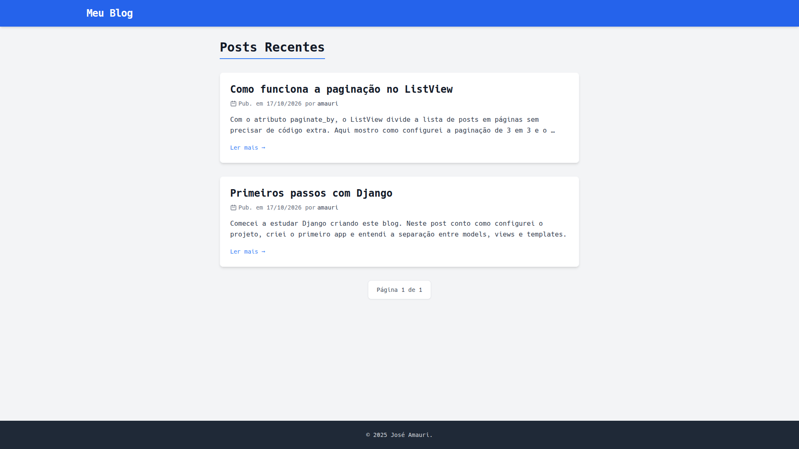
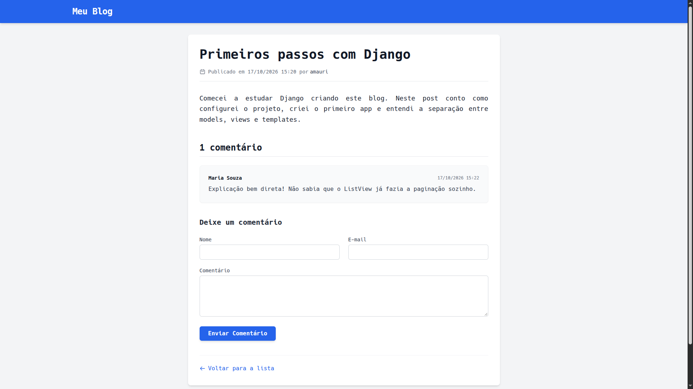

# Blog em Django

Blog feito com **Django**: lista de posts publicados com paginação, página de leitura de cada post e comentários dos leitores. Os posts e a moderação dos comentários ficam no painel administrativo.




## Funcionalidades

- **Lista de posts publicados**, do mais recente para o mais antigo, com paginação de 3 em 3
- **Página de leitura** de cada post, com URL amigável baseada na data e no slug (`/blog/17/10/2026/meu-post/`)
- **Rascunho e publicado**: só os posts publicados aparecem no site
- **Comentários**: o leitor envia nome, e-mail e mensagem pelo formulário do post
- **Moderação no admin**: ações para ativar ou desativar vários comentários de uma vez; só os ativos aparecem no post
- **Admin configurado** com filtros, busca, hierarquia por data e slug preenchido a partir do título

## Tecnologias

- Python 3.12+
- Django 6.0
- SQLite
- Tailwind CSS nos templates

## Como rodar

```bash
git clone https://github.com/JoseAmauriOP/blog.git
cd blog

python -m venv .venv
source .venv/bin/activate        # Windows: .venv\Scripts\activate

pip install -r requirements.txt
python manage.py migrate
python manage.py createsuperuser  # para escrever posts pelo admin
python manage.py runserver
```

- Blog: `http://127.0.0.1:8000/blog/`
- Admin: `http://127.0.0.1:8000/admin/`

Crie um post pelo admin com status **Published** para ele aparecer no blog.

## Como o projeto está organizado

```
blog/
├── config/            # configurações do projeto Django
└── blog/              # app do blog
    ├── models.py      # Post (com status) e Comment
    ├── views.py       # PostListView (paginada) e post_detail (com comentários)
    ├── forms.py       # formulário de comentário (ModelForm)
    ├── admin.py       # admin personalizado e ações de moderação
    └── templates/blog/
```

## O que aprendi

- Modelar relacionamentos com `ForeignKey` (post → autor, comentário → post) e usar `related_name`
- Usar `TextChoices` para controlar o status do post
- Criar URLs amigáveis com slug e data, e gerar links com `get_absolute_url`
- Usar uma view baseada em classe (`ListView`) com paginação
- Salvar o formulário com `commit=False` para ligar o comentário ao post antes de gravar
- Personalizar o Django Admin com filtros, busca e ações em lote

## Próximos passos

- [ ] Testes automatizados
- [ ] Busca de posts por texto
- [ ] Tags para organizar os posts

---

Desenvolvido por [José Amauri Patrício](https://www.linkedin.com/in/amauri-patricio-5a121435b)
